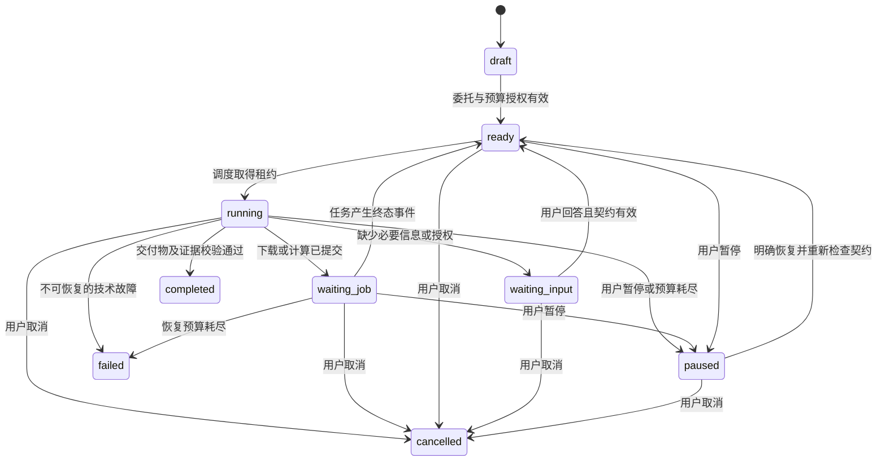
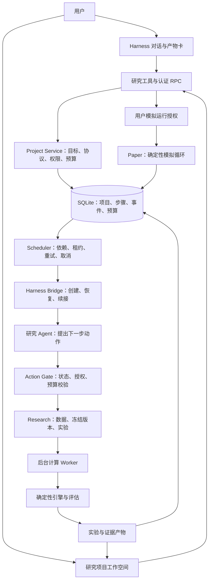

# Quant Lab Agent 产品化规划

日期：2026-10-29

状态：原始规划。已实施的 `0.2.0` 能力、实际验证证据与尚未完成的发布门槛见 [Agent 实施与验收记录](Agent实施与验收记录.md)。本文中的估算与验收目标保留为规划基线，不能视为全部已经达标。

基线：当前 `0.1.0`、DeepSeek Harness `0.2.1-rc.3`、数字资产现货研究与本地模拟盘。

本轮工作：审阅代码、复核现有自动检查、制定产品和技术路线；不改业务行为。

## 1. 要交付的产品

**用户交付一个研究目标，Agent 在明确的数据、权限和资源预算内完成研究，交付能复现的证据与结论，并持续跟踪经用户确认的模拟方案。**

当前产品的中心是策略、数据和回测这些操作对象。下一版的中心应当是“交给 Agent 的研究任务”：为什么研究、完成标准是什么、已经验证什么、下一步做什么、为什么停止、何时需要用户决定。

首个服务对象继续聚焦个人量化研究者：知道自己想检验的交易想法，但不愿反复配置下载、回测、实验对照和复盘。产品价值首先通过研究交付质量、操作节省和可追溯性验证。收益高低不能代替产品可靠性指标；一次完整研究得出“证据不足，建议终止”也属于有效交付。

本规划沿用现货、只做多、研究与模拟交易的既有方向。开发版继续借助 Harness 的模型、认证、会话和界面机制；商业托管、多用户和真实下单需要另立交付范围。实现顺序如下：

1. 完成一次可以自主闭环的研究委托。
2. 使这个闭环在失败、重启、用户中断时仍然可信。
3. 把证据、实验和决策组织成用户愿意长期使用的工作空间。
4. 验证持续模拟和复盘，再决定是否建设独立常驻部署。

### 1.1 用户实际获得什么

| 场景 | 用户提供 | Agent 负责交付 | 用户做的决定 |
| --- | --- | --- | --- |
| 检验一个想法 | 假设、市场、时间范围，或允许采用的研究默认值 | 研究计划、数据质量、基线与对照实验、结论与限制 | 接受研究范围和预算 |
| 追问一个结果 | “高收益是不是来自某一段行情？” | 分段结果、交易贡献、成本压力测试、对应证据 | 是否追加研究预算 |
| 继续上次研究 | 一个已有研究项目 | 恢复已验证事实与未完成步骤，避免重跑相同实验 | 是否调整目标 |
| 持续观察模拟方案 | 已确认的固定策略和模拟配置 | 执行健康、偏差分析、异常事件、定期复盘 | 启动、变更、恢复和停止模拟运行 |

### 1.2 第一条示范委托

> 研究 BTC 和 ETH 的小时级趋势策略。先比较均线和突破，再检查成本增加后是否还成立。最多做 12 个实验，最后给出是否值得模拟跟踪的结论。

这里的“12 个实验”只是预算交互示例。Agent 首先给出一张可编辑的委托卡，列明数据来源、实际日期区间、开发/验证/保留区间、基准、费用、风险约束、实验数和模型调用额度。缺少会改变研究结论的关键信息时提出问题；已有用户偏好和允许的研究默认值直接填入并披露。

用户确认委托后，系统自动准备数据、冻结研究版本、执行有界实验、读取真实结果、决定是否还有必要追加一个允许范围内的实验，最后生成可核对的研究报告。每个候选版本无需用户再点击“发布”。如果没有候选满足门槛，明确交付拒绝或证据不足的结果，不为凑出推荐继续寻参。

报告中的“值得模拟观察”是研究评估结果。用户仍单独确认具体策略版本、模拟资金、风险配置和运行条件，再启动模拟盘。

## 2. 现状诊断：哪些基础能保留，哪些地方造成练手感

以下结论来自当前仓库代码，不是对界面截图的推测。

| 现状与代码依据 | 对用户的影响 | 改造决策 |
| --- | --- | --- |
| `src/engine/core.ts`、`backtest.ts` 已有十进制账本、时序约定、确定性重放与基准 | 有可继续建设的计算基础 | 保留引擎，新增研究协议和更强评估 |
| `src/host/tools.ts` 提供 12 个工具，`policy.ts` 通过提示词约束每轮行为 | 能操作工具，但业务进度主要由聊天驱动 | 增加持久研究对象和可校验的下一步动作 |
| `Research.submitRun()` 要求策略先 `published` | 自动比较候选也会卡在手动发布 | 分离研究冻结与运行发布 |
| `Research.pump()` 能恢复计算任务，但任务完成不续接研究 Agent | 下载/回测完成后，用户还要继续提问 | 建设业务事件、调度、Agent 唤醒与核对流程 |
| `qt_status` 返回全库摘要，`snapshot()` 枚举所有对象 | 研究增多后混淆上下文，读取量持续增长 | 项目级上下文、摘要分页、明确选中对象 |
| 策略只有均线和突破模板，没有独立的假设、实验关系和研究结论对象 | 用户容易感觉只是表单的自然语言入口 | 建立假设→实验→证据→决策关系；再扩展策略表达 |
| 样本外区间靠用户手动划分，现有工具可读取全部数据和结果 | 研究流程难以约束反复看结果再调参 | 增加研究协议、保留区间揭示和污染记录 |
| `review()` 校验回测已完成并保存 hash，但正文是自由文本 | 有来源身份，不能保证每个数字和判断都对应证据 | 结构化结论与证据校验，叙述由已验证事实生成 |
| 首页 `SCAN/CHECK/SIZE/EXEC/LOG/EQUITY` 流程始终只高亮第一项 | 用户看到的是装饰流程，无法判断实际进度 | 用真实步骤状态、产物和事件驱动进度展示 |
| 工具卡只提示“已返回”，不展示实际业务产物 | Agent 做了什么、得到什么都不直观 | 返回可打开的研究、数据、实验和报告卡片 |
| `studio.tsx` 集中六个分区，约 1,500 行；页面每五秒读取全量摘要 | 交互围绕操作表单，后续状态维护和扩展困难 | 按研究场景拆页面、组件和查询，不先整体重写 |
| `Store.put()` 写对象和 outbox，但 outbox 只有类型、对象 ID、时间，没有消费游标和版本载荷 | 不能直接作为可恢复的 Agent 调度总线 | 增加事务事件、消费记录、版本和重试机制 |
| 模拟盘具备重启暂停和缺口保护，但生命周期跟随本地宿主 | 无法兑现全天候持续观察 | 明确本地运行状态；后续独立验证常驻部署 |

已复核的基线：2026-10-29 执行 `npm run check`，类型检查、18 项测试、构建和真实后台 worker smoke 均通过，smoke 产生 14 笔合成行情模拟成交。这证明现有工程检查通过，不能据此认定 Agent 研究质量、浏览器体验和长时间稳定性达标。本轮没有执行真实模型评测或跨日模拟运行。

## 3. 下一版必须具备的 Agent 工作闭环

### 3.1 一个研究项目，一份明确的工作契约

新增 `ResearchProject`，持久保存以下内容：

| 字段组 | 内容 |
| --- | --- |
| 目标 | 原始委托、规范化假设、市场与策略能力范围、交付物 |
| 协议 | 开发/验证/保留区间、基准、成本、数据质量要求、评估门槛 |
| 预算 | 总实验数、参数候选数、数据量、计算时长、模型请求数和 token 上限 |
| 自主权限 | 已授权数据源、可进行的研究动作、截止时间、是否允许宿主重启后自动续跑 |
| 进度 | 当前计划版本、步骤状态、已绑定的数据/策略/实验、等待原因、下一步 |
| 交付 | 已校验的证据、结论、未解决问题、终止原因 |
| 关联 | 来源聊天、专属研究执行会话、用户身份关联、对象 revision |

来源聊天用于交流，项目保存研究事实。专属执行会话承接自动工作，避免后台续跑插入用户正在进行的另一个问题。执行会话和来源聊天的宿主归档、删除及插件卸载行为，要在接入验证阶段明确，不能仅依靠内存中的 Agent 引用。

### 3.2 规划与执行的职责

首版采用**单个研究 Agent + 程序化调度和评估**。理解委托、规划下一步和反思结果是同一个 Agent 的不同步骤；数据校验、回测、评估、权限和预算由程序承担。

模型每轮提交结构化 `NextAction`，例如 `prepare_data / run_experiment / inspect_evidence / revise_plan / write_report / request_input / finish`。程序检查动作是否属于当前项目、是否满足依赖、是否超出授权及预算，再调用领域服务。模型不能直接把项目写成已完成，也不能自行放宽目标或门槛。

状态、授权和预算校验下沉到共用领域命令。所有现有 `qt_*` 工具、认证 RPC 和后台调度都经过同一校验，避免模型绕过新的动作入口调用旧工具；只读接口同样执行项目范围和保留区间访问约束。执行 Agent 只暴露当前阶段允许的动作工具，阶段性缩小上下文和可选动作。

计划允许根据证据调整，例如发现数据不足后缩小可研究范围，或发现某一假设已被否定后停止该分支。改变目标市场、风险口径、保留区间或增加预算，需要形成新协议版本并取得相应用户授权。全部实验，包括失败和无收益的实验，都保留在谱系中。

暂时不引入多个独立 Agent 和投票机制。先建立可评估的单 Agent 基线；只有在任务记录证明某个独立环节确有质量或并发收益时，再试验专门的审查 Agent，并比较额外延迟与成本。

### 3.3 研究状态机



图展示主流程。实现使用显式转换表，覆盖草稿取消、各非终态暂停、失败后建立恢复 attempt 等边界；终态不被迟到事件重新唤醒。每个转换带原因码、时间、actor、revision 和事件身份。

`completed` 表示研究交付完成，其结论可以是 `supported / rejected / inconclusive`；策略没有通过评估不等于系统故障。达到实验预算时，若能交付既定报告就结束研究；若必要步骤尚未完成，进入暂停并解释缺项，不能通过降低门槛完成任务。

### 3.4 自主执行与用户控制

| 动作 | 执行规则 |
| --- | --- |
| 查阅数据目录、准备允许来源的数据、创建候选、回测、对照、生成报告 | 在已授权委托与预算内自动完成 |
| 同一假设内追加一个预先允许的实验 | 先记录理由，预算与研究协议校验通过后执行 |
| 扩展数据源、扩大参数搜索范围、增加预算、改变目标 | 更新委托，等待必要的用户决定 |
| 冻结研究候选版本 | 自动，可回测；不可绑定模拟运行 |
| 发布用于模拟的版本、创建/启动/恢复账户、修改资金与风险 | 用户入口明确操作，绑定具体配置 hash |
| 行情过期、数据缺口、风险限额触发 | 确定性规则执行保护，Agent 解释结果 |
| 暂停研究、取消研究、停止模拟、按行情模拟平仓 | 独立、清晰的控制及反馈，不隐式混用 |

研究默认值属于实验假设；模拟盘配置属于运行授权，不能从聊天推测后自动套用。预算授权可覆盖整个委托，避免每个正常步骤都请求确认。

## 4. 研究质量：让“研究完成”有客观含义

### 4.1 研究版本与运行版本分开

引入不可变 `StrategyVersion`，区分 `research` 与 `paper_approved` 用途。研究版本记录定义 hash、父版本、生成者、理由和协议版本；修改产生新版本。模拟批准记录作为独立对象，绑定策略 hash 和运行配置 hash，保存 `approvedBy/approvedAt`。

`submitRun()` 改为接受可回测的冻结研究版本。`accountCreate()` 必须验证用户批准的运行版本与配置。保留 `createdBy`、`revisedBy`、`approvedBy` 的不同身份；当前发布时覆盖 `author` 的行为不应延续。

迁移时，旧已发布策略作为历史兼容版本保留，并标记来自旧流程。现有账户继续引用原版本，不暗中改变策略。新启动或恢复动作按新授权规则核对配置。旧实验和 hash 不重新计算、不覆盖。

### 4.2 先写研究协议，再跑候选

1. 记录假设、比较方法、参数候选上限和停止条件。
2. 按时间冻结开发、验证和最终保留区间，分别记录用途。
3. 候选选择只使用允许的开发/验证证据；选择规则和候选 hash 冻结后才揭示最终保留区间结果。
4. 检验成本变化、不同时间分段和基准下的结论稳定性。
5. 报告完整实验历史、候选数量、失败原因和已揭示区间。

揭示后继续调参会生成“已使用该区间”的记录，新候选不能继续声称对该区间保持盲测。预热数据只用于指标状态，不计入评估收益；切分边界和窗口由程序计算。滚动验证的训练、验证窗口及选择规则先冻结，不能为每个窗口事后挑选最优解释。

当前 `qt_status`、数据读取和回测结果工具都需要项目级访问约束，防止模型通过通用入口提前读取保留区间结果。本地单用户掌握原始数据，因此这里保证的是应用研究流程的可追踪性，不宣称能阻止用户自行查看本地文件。

### 4.3 评估服务

新增确定性 `EvaluationService`，输出 `pass / fail / insufficient`，附原因、事实字段和证据引用。门槛由项目协议冻结；收益、回撤、样本数等具体数值需要根据目标用户任务校准，不在此规划中宣称存在通用有效值。

| 检查 | 输出 |
| --- | --- |
| 数据完整性与实际覆盖 | 是否缺口、是否混用合成数据、实际评估区间与请求差异 |
| 比较口径 | 市场、区间、资金、成本、交易规则、引擎版本、基准版本是否一致 |
| 样本充分性 | 区间长度、有效日收益数、交易样本，哪些指标不能解释 |
| 基准与风险 | 相对基准、回撤、敞口、交易集中和风险约束触发情况 |
| 稳健性 | 成本变化、时间分段、有限参数邻域、预先定义的滚动验证 |
| 研究完整性 | 是否超出计划候选、是否反复使用已揭示区间、失败实验是否遗漏 |

现有 `qt_runs_compare` 排除了 `engineVersion`，后续比较必须显式显示引擎差异；规范化交易对/数据身份顺序后计算比较口径，不能把数组排列变化等同于研究条件变化。

基准计算也需要版本化，并验证与策略收益采用一致的期末估值和成本口径。报告既保存数值，也保存指标定义，避免不同版本间直接比较同名字段。

### 4.4 证据与报告

新增 `EvidenceRef`：`projectId / experimentId / runId / manifestHash / resultHash / path / scope / asOf`。引用逐笔信息时再带 `decisionId/orderId/fillId`；引用聚合指标时说明覆盖区间及样本。

报告分为程序事实、模型解释和待验证假设。用于呈现的收益、费用、回撤等数字由程序按引用填充，校验失败阻止交付。模型生成的解释必须关联支持或反驳证据，保留不确定性；另一个模型的赞同不能替代数据验证。

最终产物至少包括：结论、适用范围、研究协议、数据来源、全量实验矩阵、基准与稳健性结果、失败/未完成项、是否满足模拟观察条件、下一步选项。导出 Markdown/JSON 时包含足够的版本与 manifest 信息，使报告离开聊天后仍能追溯。

## 5. 技术架构与 Harness 接入



保留 TypeScript、SQLite 和现有计算引擎。研究调度与模型推理分开：等待下载、回测和行情时不持续调用模型。第一版单机单执行者，有界 I/O 队列与计算队列分别调度，避免当前下载优先顺序长期阻塞回测。

### 5.1 可复用的宿主能力与待验证项

已检查本机 `@deepseek-ai/dsh-agent@0.2.1-rc.3` 的 README 与类型：注册表提供 `create/resume`，Agent 提供 `followup/steer/inject/cancel/whenIdle`；创建和恢复时可以组合作用域工具。`inject` 本身不唤醒闲置 Agent。正式实现优先封装这些公开接口，不建设第二套模型客户端。[官方 Agent 文档](https://github.com/deepseek-ai/deepseek-harness/blob/master/packages/core/agent/README.md)

这些接口存在，不等于本项目已经具备后台 Agent。实施前必须完成一个可运行的接入原型，验证：

1. 使用锁定版本的实际 agent-loop 工厂创建专属研究执行会话，继承正确的模型选择，工具仅限量化领域。
2. 回测完成后，由插件来源的 `followup` 唤醒闲置执行会话；忙时排队并保持归属。
3. 宿主重启后恢复持久会话和量化项目的关联，不因内存注册表为空丢失进度。
4. 模型配置失效、用户归档或删除来源聊天、插件卸载时，项目进入正确状态，不复活用户已停止的工作。
5. 取消专属执行 Agent 不影响用户的普通聊天；会话资源释放与历史保留行为符合预期。
6. 核实请求事件、用量事件、取消与模型自动重试的准确边界，明确哪些预算可以硬限制。

宿主扩展示例使用定时事件通过 `followup` 投递工作，可作为接入方向；业务任务的持久状态和重复投递处理仍由本项目承担。[官方扩展示例](https://github.com/deepseek-ai/deepseek-harness/blob/master/docs/cookbook/extension-cookbook.md)

若锁定版本无法满足某项关键生命周期约束，先提交最小升级或适配决策与兼容验证，再继续建设。不能用隐藏对话消息循环掩盖接入不可靠的问题。

### 5.2 持久任务、事件和重复投递

新增 `projects / plans / steps / attempts / project_events / event_consumptions / budget_reservations / approvals` 等关系表和索引；大型结果移入按 hash 存放的产物文件，SQLite 保存摘要、引用和可查询元数据。

每次业务状态变更与对应事件在同一事务提交。事件包含稳定 ID、项目 ID、对象 revision、因果关系和必要载荷，避免消费者读取到已被覆盖的新状态后无法解释旧事件。模型请求和文件/网络 I/O 不放在 SQLite 写事务中。

调度步骤：领取有租约的可执行步骤→预留预算→持久化 attempt→投递执行消息→核对执行结果→提交步骤结果与下一事件。幂等身份由 `projectId/stepId/actionRevision` 派生，不能每次由模型随机生成。

SQLite 与 Harness 会话日志无法原子提交，因此投递语义采用至少一次，并用 `dispatchId`、宿主消息身份、项目步骤版本和工具幂等共同处理重复。不得声称整个系统恰好执行一次。崩溃窗口包括“消息已入宿主 inbox，但消费确认未落库”；重启先核对收件箱和已提交结果，再决定是否补投。重复唤醒不能重复创建实验或推进步骤。

模型调用已发生但用量或结果未落库时，标记 `outcome_unknown`，优先从持久日志核对；不能简单退款预算再重发。无法核对则保守保留消耗并暂停需要精确额度的后续调用。

### 5.3 预算与停止规则

预算是整个研究委托的资源约束，覆盖跨轮次、重试和重启。数据库事务先预留后执行，完成后结算；同一实验请求在核对实际创建状态后处理预算，失败尝试仍计入计算或模型消耗。

第一版可确定执行的硬上限：实验创建数、候选数、任务并发数、单次数据量、计算任务时限、项目截止时间。模型请求数和输出 token 上限通过宿主适配层落实；输入 token、宿主自动重试和金额额度的精确控制，需要接入原型验证。若宿主无法提供可靠的调用前限额，不展示“精确费用封顶”，而采用保守预算和可核对用量。

重复相同失败、同一实验 manifest、没有新证据的反复规划、超出能力范围或达到资源上限，都需要明确终止或等待原因。网络故障只对可重试错误做有限退避；参数错误和授权失败不循环重试。没有状态变化时不产生“仍在运行”的模型调用。

### 5.4 暂停、取消、恢复

暂停研究：停止派发新动作，可选择让已在运行的计算结束并保存结果；必须在界面说明该语义。取消研究：标记取消意图、递增执行代次、撤销队列并取消可取消的任务；迟到结果可以归档，但不能继续推进项目。

取消与结果落库都检查同一项目 revision/执行代次，取消成功后不得产生新步骤。原始聊天的“停止生成”继续只控制该次聊天；研究卡提供“暂停研究”和“取消研究”入口。

重启研究时，重建租约与未完成步骤，核对实际任务和产物。只有原委托明确允许重启后继续、未过期且未被撤销时自动续跑，否则显示待恢复。模拟盘继续沿用重启后暂停、人工恢复和不补记观察缺口成交的规则。

### 5.5 上下文与记忆

每次执行读取一个有界项目摘要：目标、协议、预算余量、当前步骤、关键事实、最新相关实验、待决定事项和有效证据 ID。历史详情按需分页检索，替换“每轮把全库状态塞入模型”的方式。

用户偏好、项目事实和模型假设分别保存。记忆条目带来源、适用范围、版本或有效期；配置事实以结构化对象为准，旧聊天摘要不能覆盖它。先使用 SQLite 索引和结构化检索，只有真实任务证明需要语义检索时再引入向量存储。

任务记录保存动作、理由摘要、工具输入输出身份、证据和结算信息，不以暴露模型内部思维过程作为可解释性。跨上下文交接依赖持久产物和下一步状态；这一方向也与长任务工程中使用明确进度和交接产物的经验一致，具体领域协议由本项目设计。[长任务工程参考](https://www.anthropic.com/research/effective-harnesses-for-long-running-agents)

## 6. 产品界面：让用户看见委托如何被完成

### 6.1 主入口

首页首要入口改为“提出研究目标”和“继续研究”。示例数据进入次级的体验入口，标注合成来源。首页展示当前项目、需要决定的事项、最近交付及模拟健康；对象总数放入次级信息。

保留 Harness 聊天，右侧工作空间采用项目导航。依照宿主已有 sidebar 的展开能力提供宽视图，先验证表格和证据联动能满足需要；不预设必须另建一套独立网站。

| 视图 | 用户能立即判断的事情 |
| --- | --- |
| 委托总览 | 目标、当前阶段、已完成/计划实验、剩余预算、阻塞和下一步 |
| 研究计划 | 每个步骤的理由、依赖、状态、产物及计划变更 |
| 实验矩阵 | 假设/参数/区间/成本/基准/样本、失败原因、比较口径 |
| 证据与报告 | 结论点选后定位指标、图表和交易；清晰区分事实和解释 |
| 模拟运行 | 固定运行版本、批准配置、健康、观察缺口、决策、偏差和控制 |

数据目录、策略编辑、导入和备份保留为高级入口；常规研究流程通过项目协调这些对象。工作空间中选中的项目、实验或证据，可以带入聊天；模型工具默认以可信会话绑定的当前项目为作用域。

### 6.2 一个进行中的研究卡应呈现什么

```text
BTC / ETH 趋势研究                      正在比较候选
目标：检验趋势假设在成本压力下是否成立
已完成 4 / 最多 12 个实验 · 剩余模型额度可查看

已完成：数据质量检查、基线、均线候选
当前：突破候选回测 · 已处理数据 63%
接下来：按预定规则比较，然后做成本压力检验
最近发现：一个候选在验证期回撤超过本项目上限

[查看证据] [调整委托] [暂停研究] [取消研究]
```

以上为界面文案示意，不是真实运行结果。计算进度与研究进度分别表达：无法估算总工作量时显示完成步骤及当前活动，不显示虚构的总百分比。

### 6.3 工具卡与通知

工具卡展示实际产物，例如“数据检查完成：覆盖区间、缺口与来源”“实验完成：结果、口径、证据链接”“研究暂停：预算已用尽及未完成项”。必须区分工具提交成功、后台任务完成和研究交付完成。

通知只在研究交付、技术失败、需要用户决定、模拟异常和约定复盘到期时出现；同一故障按事件身份合并，恢复时更新状态。普通进度留在时间线，不以周期性消息打断用户。

UI 拆分为项目、计划、实验、报告和模拟组件；查询按项目分页，并通过有游标的更新接口或宿主兼容事件机制刷新。隐藏面板减少刷新，断线后按游标补齐。先取消全量对象轮询依赖，再按实际数据量优化实时链路。

### 6.4 首次使用与故障自助

首次进入时检查模型是否配置、研究服务是否可用、存储是否可写、后台 worker 是否能启动、所选公共数据源是否连通。分别显示可用能力和失败原因，并给出直接可执行的恢复入口；数据源不可用时仍可导入数据完成研究。日期默认值使用可获取的已收盘区间，不沿用硬编码的过期演示日期。

提供一条短委托作为引导，先展示最终会收到的研究产物、预算和必要决定，再开始执行。新用户不需要先理解策略发布、数据快照 ID 或 worker。设置与诊断页集中展示宿主/插件/引擎版本、存储位置、执行健康和最近故障；导出的诊断信息排除凭据和无关聊天内容。

## 7. 持续模拟与策略能力的后续扩展

### 7.1 持续模拟 Agent

行情执行循环保持确定性，Agent 在事件或复盘周期触发时读取事实，解释执行偏差和研究假设变化，提出新研究任务或运行变更建议。信号、订单、账本与风险保护不等待模型。

追踪模拟收益与历史预期区间、实际费用假设、观察缺口、风险事件、交易频率和数据新鲜度。偏差规则、告警条件及建议动作可核对。对账和监控先于自动优化；任何运行版本切换都创建新的用户确认记录，不能把新研究参数直接写入运行账户。

阶段门槛是长时间真实公共行情观察与故障演练通过；当前单元测试和公共端点连通性不能替代这些证据。本地宿主离线时无法监测，界面始终展示上次观测时间和健康来源。

### 7.2 策略表达扩展

首条闭环继续使用已有模板，先验证 Agent 研究价值。遇到能力外的用户想法，要明确哪些规则表达不了，不能偷偷替换为近似模板后声称完成原目标。

后续引入受限策略表达：指标、比较、逻辑组合、进出场条件及仓位规则组成有界表达式树，编译为共享确定性执行语义。定义允许指标、预热上限、节点数量和计算预算；同一版本用于回测与模拟，加入未来数据污染和跨模式一致性测试。

先扩展少量来自真实用户任务的规则。任意 Python/JS 执行需要单独的隔离、依赖、资源和复现设计，不能顺带塞进模板扩展。

### 7.3 常驻部署

当用户明确需要关闭电脑后继续运行，再验证 Harness headless 等官方运行形态的最小插件组合、认证、模型配置、状态卷、重启及健康探针。后台运行进程拥有执行租约，浏览器是客户端，不能靠前端页面维持调度。[官方架构与运行形态](https://github.com/deepseek-ai/deepseek-harness/blob/master/docs/architecture.md)

常驻模式交付需包含独立部署说明、进程守护、日志轮转、备份恢复演练、宿主/worker 健康、时钟与数据过期检测和运行可用性观测。在此之前只承诺进程存活期间的本地运行。

## 8. 从当前代码落地

以下为建议模块划分；实现可按阶段拆出，避免先进行没有行为交付的大重构。

| 现有位置 | 处理 | 新增职责/建议位置 |
| --- | --- | --- |
| `src/domain/contracts.ts`、`schemas.ts` | 保留交易契约，拆出研究契约 | `project.ts`、`experiment.ts`、`evidence.ts`、`authorization.ts` |
| `src/domain/policy.ts` | 改成面向研究状态和产物的指引 | 权限、预算、完成条件移到程序校验 |
| `src/host/research.ts` | 提取数据、版本、实验与计算队列边界 | 供聊天工具与 Scheduler 共用的领域命令 |
| `src/host/store.ts` | 增加版本化迁移、可查询表、事务事件和游标 | `migrations/`、项目及执行存储接口 |
| `src/host/index.ts` | 精简全量快照为兼容入口 | 项目摘要与分页查询 |
| `src/host/tools.ts` | 保留已有领域读写，接入项目作用域 | `qt_project_*`、`qt_plan_*`、`qt_experiment_*`、证据读取 |
| `src/host/rpc.ts` | 复用认证入口 | 委托授权、预算、项目控制、批准配置 |
| 新增 `src/agent/` | 持久研究协调 | `project-service.ts`、`scheduler.ts`、`harness-bridge.ts`、`action-gate.ts`、`context.ts` |
| 新增 `src/research/` | 研究质量 | `protocol.ts`、`evaluation.ts`、`report.ts` |
| `src/engine/`、`src/workers/` | 复用纯计算与 worker | 版本化指标/基准、稳健性任务、受限表达能力 |
| `src/client/studio.tsx` | 按项目场景渐进拆分 | `projects/`、`experiments/`、`reports/`、`paper/` |
| `src/host/paper.ts` | 保留确定性执行 | 输出健康与领域事件，供复盘读取 |

从 schema 1 升级要有显式迁移和失败回滚，不通过“创建缺失表”替代迁移。备份格式同步版本化，包含新项目、协议、预算和证据引用。旧目录迁移前备份；恢复到临时目录验证引用、账本和历史实验可读后，才能交付升级。

部署保持一个本地库对应一个拥有者和一个有效执行租约。项目 ID、聊天 ID 是对象关联，不能当授权凭据；模型执行上下文绑定允许访问的项目，运行批准由可信用户入口创建。多租户不在本阶段假设内。

## 9. 实施顺序与每阶段的交付门槛

估算按一名熟悉 TypeScript/Harness 的开发者持续投入、沿用现有引擎计算；每阶段结束后依据实际问题重估。周数用于排优先级，不是交付承诺。P0 的宿主接入验证失败时，先处理依赖，不能照原日程宣称可交付。

| 阶段 | 预计投入 | 必须交付 | 进入下一阶段的条件 |
| --- | --- | --- | --- |
| P0：验证关键假设 | 3–5 个工作日 | 后台 Agent 接入原型；目标任务集；项目/协议/授权契约；一次真实模型端到端记录 | 能完成回测后续跑、重启恢复和取消；预算可执行范围明确 |
| P1：首条自主研究闭环 | 约 2 周 | 项目、步骤、事务事件、预算、研究冻结版本、受限 NextAction、基础报告与任务卡 | 给一个受支持委托，确认一次后自动准备数据、完成少量对照实验并交付；无逐候选发布 |
| P2：研究质量与正式工作空间 | 约 2 周 | 样本划分/揭示、评估门槛、证据校验、实验谱系、项目页面、浏览器 E2E | 研究拒绝与证据不足路径正确；所有关键数字可定位；目标任务评测达标 |
| P3：持续模拟与小范围试用 | 约 2 周 | 事件复盘、异常告警、观察缺口说明、迁移/恢复演练、7 天观察记录、试用反馈 | 故障恢复、通知去重、固定运行版本、用户控制通过；用户能独立完成任务 |
| P4：按实际需求扩展 | 单独估算 | 受限策略表达、更多市场/数据能力、常驻运行形态 | 先证明现有能力限制确实阻碍用户任务，再逐项投入 |

首个可试用的研究 Agent 目标在 P1 结束形成；达到完整 Beta 门槛预计约 6–8 周。策略表达扩展和全天候托管不混入这一估算。

### 9.1 P0 的具体顺序

1. 先写五个代表性用户任务，包括标准委托、已有项目继续、数据失败、证据不足、能力外请求，明确每个任务应交付什么。
2. 用一个真实模型和受控工具任务验证专属 Agent 会话生命周期；另用确定性驱动注入重复事件、进程中断和迟到结果。
3. 完成项目/步骤/预算/证据/授权契约及数据库迁移设计，冻结第一条闭环范围。
4. 验证研究冻结版本能直接回测，但无法创建或启动模拟账户。
5. 演示“输入目标→确认委托→自动做基线与一个对照→读取结果→交付可核对结论”。

第 5 步是接入与产品形态验证，不代表 P1 的可靠性和报告已经全部实现。第一项开发应服务于这条闭环，而不是先扩充模板、视觉效果或多个 Agent 角色。

## 10. 验收与评测

### 10.1 测试分层

| 层级 | 必须覆盖 |
| --- | --- |
| 确定性领域测试 | 版本不可变、授权绑定、预算并发预留、状态转换、幂等和比较口径 |
| 调度故障测试 | 事件重复、先入宿主 inbox 后崩溃、结果后取消、租约丢失、重启、outcome_unknown |
| 真实 Harness 集成 | create/resume/followup、工具作用域、来源归属、归档/卸载、取消与模型用量边界 |
| 研究协议测试 | 预热不计收益、保留区间不可提前读、揭示后修改留痕、失败实验不遗漏 |
| 报告校验 | 错误 runId/hash、失效路径、跨项目引用、编造数字、样本不足及口径不一致 |
| 浏览器 E2E | 新建委托、查看进度、打开证据、断线恢复、暂停取消、模拟授权、宽窄视图 |
| 真实模型评测 | 使用固定任务集和固定数据，记录模型/提示词版本、动作、耗时、用量和人工评分 |
| 持续运行 | 7 天公共行情观察，记录断线、过期、重启、告警、账本一致性和内存趋势 |

工具模拟可以验证调度与失败机制，不能作为真实模型研究质量通过的证据。浏览器视觉和交互需实际运行，组件测试不能代替。持续观察周期是经过的真实时间，不能压缩为单元测试后声称已经完成。

### 10.2 Beta 候选门槛

以下为拟定产品验收目标，P0 固定任务集后可调整一次并记录理由；不能为使某次模型结果通过而事后改标准。

| 指标 | 初始目标与测量口径 |
| --- | --- |
| 支持范围内研究完成率 | 20 个固定任务，各重复 3 次；至少 85% 在预算内交付满足协议的产物，拒绝/证据不足按事先评分规则计入 |
| 关键事实引用 | 验收报告展示的关键数字全部通过程序证据校验；缺失引用不允许交付 |
| 授权及预算 | 对抗与并发测试中越权运行、超预算创建和预算重置均为 0 |
| 恢复正确性 | 故障矩阵各执行至少 3 次；无重复实验、终态复活、取消后续跑及账本不一致 |
| 操作负担 | 标准受支持委托确认后，不要求用户逐候选发布、选择数据或轮询任务；改变契约才产生新的必要决定 |
| 产品可理解性 | 5 位目标用户独立试用，至少 4 位无需开发者指导完成委托并定位一项结论的证据 |
| 摘要响应 | 固定基准机、1,000 条实验摘要的项目列表请求 P95 小于 500ms；分页返回且不读取全量结果产物 |
| 持续运行 | 7 天观察无未解释账本差异；故障及停机有明确记录，不能将人工重启掩盖为连续在线 |

同时记录每个任务的模型请求、输入输出 token、计算时长、峰值内存、完成延迟和人工介入次数。先建立成本基线，再设金额目标；记录不了的费用字段不能默认填零。

## 11. 近期决策与暂缓投入

近期按此方案采用：研究项目为主对象、单研究 Agent、程序化动作门控、委托级授权与预算、自动冻结研究版本、证据驱动报告、模拟运行独立确认、渐进式重构现有插件。

暂缓：多个 Agent 扮演交易团队、任意策略代码执行、大规模参数搜索、多个交易所同时接入、多租户平台、自建模型网关、真实订单通道。它们都不能替代首条研究闭环的质量验证。

是否发展成独立常驻产品、支持哪些新增策略规则和数据源，由试用任务、实际失败原因和用户持续使用情况决定。最早需要获得的产品证据，是用户能够把一个真实研究问题交给它，离开操作流程后仍收到完整、可信、可追溯的交付。
