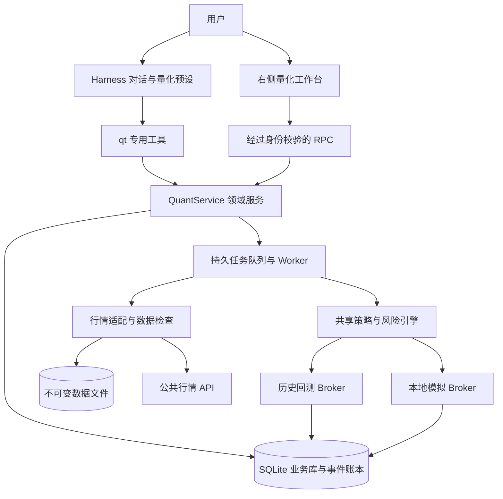

# 基于 DeepSeek Harness 的量化交易助手开发方案

版本：v0.1  
日期：2026-10-28  
状态：待评审方案；当前仅交付文档，未实现下述功能。  
首版方向：**数字资产现货，先回测与模拟交易**，已由用户确认。

## 1. 产品定位与关键决策

面向个人量化研究者，构建一个能把自然语言交易想法转化为可验证策略、历史回测和持续模拟交易的助手。用户在 Harness 中交流，在右侧量化工作台检查策略、数据、交易与权益；每个结论都能追溯到具体版本和计算记录。

首版交付一条完整路径：

> 提出策略想法 → 生成结构化策略 → 检查历史数据 → 回测与对照 → 用户启动模拟盘 → 查看每次决策 → 复盘与新版本迭代。

| 决策 | 首版选择 | 理由 |
| --- | --- | --- |
| 产品形态 | Harness 插件包 + 本地 Web 启动覆盖层 | 复用参考项目已采用的集成路径 |
| 市场 | 单一中心化交易所的现货、统一 USDT 计价、只做多 | 收敛撮合、估值和账本复杂度 |
| 行情来源 | 优先实现 Binance 公共行情适配器；支持本地 CSV 导入 | 提供实际数据入口，也能离线复现 |
| 初始交易对 | BTCUSDT、ETHUSDT，用户可从支持列表调整 | 控制首版数据与验证规模；仅作开发默认值 |
| 策略输入 | 自然语言草拟 + 类型化模板参数 | 使执行规则可校验、可比较 |
| 计算与交易 | 确定性 TypeScript 引擎 | 不依赖每根 K 线调用模型 |
| 运行模式 | 历史回测、本地模拟盘 | 建立可重放、可核对的研究闭环 |
| 持久化 | SQLite 保存业务与账本；不可变文件保存数据快照 | 易部署，支持单机审计与恢复 |
| 真实交易 | 后续独立阶段 | 首版不需要交易密钥，也不实现真实订单写接口 |

行情适配器是接口选择，不意味着已验证用户所在地的服务可用性。实施时先做公共端点连通性检查；不可用时支持本地数据和后续替代适配器，不自动切换到不明代理。

## 2. 参考项目和交易终端图的使用方式

### 2.1 已检查的本地依据

当前项目目录只有 `20261028224431_1_5.jpg`，尚无业务代码和 Git 仓库。

已查看 `/Users/ac/Downloads/GitHub/poems-of-mao` 的 README、依赖配置、插件 patch、宿主服务、工具、RPC、客户端注册、启动构建脚本及 Harness 集成测试。该项目本地声明兼容 Harness `0.2.1-rc.2 / rc.3`，开发依赖使用 `0.2.1-rc.3`，Node.js 要求 `>=22.22.0`。这些是参考项目的已声明配置，不等于本项目已完成兼容验证，也不代表官方最新版本。

| 参考文件 | 可借鉴的机制 | 本项目中的对应设计 |
| --- | --- | --- |
| `cordis.patch.yml` | 注册领域服务、RPC 与专用 preset | 量化服务、量化 RPC、量化研究预设 |
| `src/host/index.ts` | Cordis Service、配置目录、资源释放 | `QuantService` 管理数据、任务与账本 |
| `src/host/tools.ts` | `defineTool`、工具作用域、系统提示词 | 量化专用 `qt_*` 工具 |
| `src/host/rpc.ts` | 结构化请求、校验、统一错误返回 | 工作台与领域服务之间的 RPC |
| `src/client/index.tsx` | 公开 slots、工具卡、右栏 tab、输入插入接口 | 量化工作台与运行结果卡 |
| `src/host/library.ts` | SQLite、事务、版本与提交身份 | 策略修订、幂等任务、成交与账本事务 |
| `scripts/launch.mjs` | `dsh --profile web --patch` 启动 | 项目级本地开发入口 |
| `scripts/build.mjs` / `freshness.mjs` | 宿主/浏览器分包、构建指纹 | 防止旧构建和宿主代码进入浏览器 |
| `tests/harness.test.ts` | 真实 Cordis、Tools、scope 注册验证 | 验证工具权限与取消行为 |

只参考工程机制，重新建立量化领域模型。交易账户可以被多个研究会话查看，因此不能照搬“一会话拥有一份全部业务状态”的学习库结构。RPC 身份和模拟盘生命周期也需要单独设计。

### 2.2 图中的流程映射

参考图的价值是让用户看见自动流程，以及每次交易或放弃交易的原因。图中数字和收益不可当作可验证业绩。

| 图中角色 | 本产品模块 | 用户可见结果 |
| --- | --- | --- |
| Scanner | 信号扫描 | 命中条件、观察时间、策略版本 |
| Rug Check | 市场与数据检查 | 支持状态、数据完整性、交易精度、拒绝理由 |
| Sizer | 仓位与风险计算 | 建议数量、约束上限、计算依据 |
| Executor | 模拟执行器 | 委托、成交、费用、滑点与状态 |
| Logger | 决策事件与交易日志 | 交易和未交易的完整原因链 |
| Equity | 账本与权益投影 | 现金、持仓、已实现/未实现盈亏、回撤 |

图中的新币、合约权限、LP 锁定属于链上交易领域。首版使用中心化交易所现货数据，检查范围如上，不显示虚构的“链上安全通过”。这些模块先实现为领域服务与状态卡，不要求六个独立 AI Agent。

## 3. 首版范围与用户体验

### 3.1 必须完成

1. Harness 量化研究预设、系统提示词、专用工具和右侧工作台。
2. 交易对目录、历史 OHLCV 下载/导入、质量检查与不可变数据快照。
3. 两个策略模板：均线交叉、区间突破；草稿、参数校验、版本比较与发布。
4. 历史回测：固定成本假设、逐笔记录、净值、回撤、基准及样本外结果。
5. 模拟账户：初始资金、冻结资金、现货持仓、撮合、风险限制和可核对账本。
6. 用户启动/暂停/停止模拟任务，故障状态、断线恢复、运行日志与导出。
7. AI 对策略和真实工具结果做解释、比较与复盘，所有建议保留作者身份。

### 3.2 留到后续阶段

真实下单、杠杆和合约、做空、多交易所聚合、链上新币交易、订单簿级撮合、任意 Python/JS 策略执行、自动大规模寻参、多租户协作和独立云端全天候服务。

首版进程存活时支持模拟运行；电脑休眠、应用退出或宿主终止后不能继续监控。恢复时明确显示观察缺口，不能把缺口期间的假想成交写入实时模拟账本。

### 3.3 一次完整使用流程

用户：“把 BTC 的均线交叉想法做成策略，先回测，再决定要不要模拟运行。”

1. AI 读取当前研究上下文和可用模板，草拟策略卡，展示周期、参数、进出场条件及缺失项。
2. 用户在工作台修改并发布版本；发布只冻结定义，不启动运行。
3. 数据检查展示覆盖日期、缺口、来源、快照 hash；不完整时给出补数或缩小区间入口。
4. 用户或 AI 提交有界回测任务，立即返回任务 ID；计算在 worker 中运行，聊天保持可响应。
5. 工作台展示净值、最大回撤、交易明细、成本敏感性和基准。AI 解释失效场景，并标注样本不足。
6. 用户在工作台选择模拟账户和风控配置，查看完整运行配置后点击启动。
7. 引擎按已发布规则运行；用户可问“这根 K 线为什么没有买入？”并定位到拒绝原因与数据。
8. 复盘生成新草稿版本，正在运行的任务继续使用旧版本；切换版本需用户明确操作。

### 3.4 右侧量化工作台

| 分区 | 主要内容 |
| --- | --- |
| 总览 | 当前模式、运行健康、数据更新时间、账户权益、风险与近期决策 |
| 策略 | 模板、草稿、参数、版本差异、发布状态、带入对话 |
| 数据 | 来源、交易对、时间范围、质量报告、下载/导入、历史快照 |
| 回测 | 任务状态、配置、收益曲线、回撤、基准、逐笔记录、比较 |
| 模拟盘 | 账户、现金/冻结额/持仓、运行控制、订单与成交 |
| 日志与复盘 | 时间线、拒绝码、证据定位、AI 注释、导出 |

在宿主现有布局内使用紧凑卡片、可展开明细和折叠区。采用图中“状态→流程→明细→结果”的信息顺序，中文优先，支持宿主主题。模式和数据时间始终可见；收益颜色之外同时显示正负号。较宽图表是否支持展开，先验证宿主公开接口再决定。

“带入对话”仅通过公开输入插入接口放入对象摘要，交由用户发送。工具结果卡关联真实 `runId`；失败、取消、处理中、成功分别呈现。

## 4. Harness 集成和系统架构

官方架构以 Cordis 插件、profile、bundle 与 patch 组合应用。本方案沿用这一入口，模型、登录、消息流和会话交给宿主；量化插件负责领域能力。[Harness 官方架构](https://github.com/deepseek-ai/deepseek-harness/blob/master/docs/architecture.md)



### 4.1 插件边界

- 暂定包名 `@quant-assistant/harness-plugin`；根入口提供 `QuantService`，子路径 `/tools` 和 `/rpc` 提供领域工具与前端通信，`./client` 提供工作台。
- bundle patch 插入服务、RPC 和 preset `quant-research`，工具只挂到该 preset。客户端通过 `sidebarRightTabs`、公开 slots 和工具视图注册。
- 开发启动生成绝对路径 patch，执行项目锁定版本的 `dsh --profile web --patch ...`。正式插件包通过宿主插件机制安装；Desktop 使用其自带运行时单独验证。
- 不新增第二套模型客户端、独立聊天存储或直接改宿主源码。自有代码默认不提供 Shell、任意文件读写、通用 HTTP 和真实交易工具。
- 对象身份从可信执行上下文取得，AI 不传入身份字段。业务库保存 Harness `sessionId` 的关联，不把它当作账户授权凭据。

插件注册与资源释放参照官方开发入口；后台 timer、网络连接、worker 需要随插件卸载停止。[Harness 插件开发](https://github.com/deepseek-ai/deepseek-harness/blob/master/docs/user/develop/basic/index.md)

### 4.2 技术栈与版本策略

| 层 | 拟采用方案 |
| --- | --- |
| 运行时 | Node.js `>=22.22.0`，初始兼容基线对齐参考项目 |
| 宿主 | Harness `0.2.1-rc.3` 为首个验证目标；锁定实际安装版本 |
| 语言/校验 | TypeScript、Zod；Harness 配置使用其对应 Schemastery |
| 前端 | React 18、宿主公开客户端 API、SVG 图表；复杂图表库按需引入 |
| 存储 | `node:sqlite`、WAL、版本化迁移、备份清单 |
| 数值 | 十进制定点/十进制库计算金额和数量；JSON 用十进制字符串 |
| 计算 | Worker Thread、共享引擎、任务资源限制、可取消运行 |
| 构建/测试 | esbuild、TypeScript、Node Test、真实 Harness 注册与客户端加载验证 |

首个技术任务是验证本机 API 与锁定版本一致。官方 master 文档用于架构核对，不能直接替代已安装版本的类型和运行验证。本轮没有安装新依赖或运行兼容测试。

首版保持单一 TypeScript 技术栈；有具体研究需求后再增加 Python worker，避免先建设跨语言平台。

### 4.3 AI 与引擎的职责

| AI 可以做 | 由程序保证 | 仅由用户控制 |
| --- | --- | --- |
| 根据想法草拟模板参数 | 参数类型、版本冻结、交易规则 | 发布策略、选择模拟账户 |
| 请求有界数据任务与回测 | 数据校验、指标、费用、风控 | 启动/恢复/停止模拟任务 |
| 读取结果、比较实验 | 订单状态、余额、持仓、收益计算 | 更改资金与风控配置 |
| 保存带引用的解释与复盘 | 权限、幂等、取消、事件完整性 | 导入恢复覆盖、备份管理 |

模型输出不能写入成交、权益或风控通过标记。运行循环不等待模型，模型不可用时已启动的模拟任务仍按固定规则运行，AI 解读显示暂不可用。

## 5. 策略与行情契约

### 5.1 策略定义

策略使用版本化配置，不执行模型生成的任意源码。模板实现为经过测试的纯函数；自然语言只能生成符合 schema 的草稿。

```json
{
  "schemaVersion": 1,
  "template": "sma_cross",
  "market": "spot",
  "symbols": ["BTCUSDT"],
  "timeframe": "1h",
  "parameters": { "fastPeriod": 20, "slowPeriod": 60 },
  "direction": "long_only",
  "signalTiming": "closed_bar",
  "executionTiming": "next_bar_open"
}
```

以上数值用于说明配置结构，不表示已选择的盈利参数。运行配置另行绑定资金、风险、手续费、滑点、数据快照、引擎版本和随机种子。

- 均线交叉：快线上穿慢线产生开仓意图，下穿产生平仓意图；按明确的前后两根收盘值判断交叉。
- 区间突破：已收盘价格突破此前 N 根已收盘 K 线的高点区间，离场规则为此前 M 根低点；区间不包含当前信号 K 线。
- 指标未预热、数据缺口、参数非法或交易对不支持时不发开仓意图；保留原因码。
- 发布版本后不可覆盖。修改生成新版本；运行始终绑定具体版本和引擎 hash。

### 5.2 数据接入

首个适配器使用公共 K 线 REST 下载历史、公共 WebSocket 订阅已收盘 K 线，REST 负责重连补数；本地 CSV 遵循相同规范。公共端点的具体分页、限流和返回字段以实施时官方文档为准。[现货 REST API](https://github.com/binance/binance-spot-api-docs/blob/master/rest-api.md)

数据记录至少包含：`venue / market / symbol / interval / openTime / closeTime / availableAt / OHLCV / source / fetchedAt / schemaVersion`。时间内部统一 UTC，界面默认 Asia/Shanghai，导出显式带时区；金额、价格与数量以十进制字符串保存。

质量检查覆盖排序、重复、间隔、OHLC 关系、负成交量、未收盘 K 线、非有限值与缺口。缺口不能用零成交或前值静默填平。只有质量检查通过的数据分段才可用于首版正式回测；缺失区间可补齐或由用户缩小范围。

每份快照记录请求区间、实际覆盖、原始响应 hash、规范化数据 hash、适配器版本和质量报告。修正数据生成新快照，不覆盖旧实验。先写临时文件、校验 hash、原子重命名，再事务登记 ready manifest；只有 ready 数据可调度。孤立文件可在维护时识别，不让半成品进入引擎。

WebSocket 需要心跳、连接更新和退避重连，不能假设长连接永久有效；已收盘事件依据服务端关闭标记去重。[行情流官方文档](https://github.com/binance/binance-spot-api-docs/blob/master/web-socket-streams.md)

### 5.3 历史可用性与偏差

- 策略在时点 T 只读取 `availableAt <= T` 的数据；预热数据可以早于报告区间，但不计入报告交易与收益。
- 首版明确采用用户指定的固定交易对池，不声称复原历史全市场选币；记录由今天选择交易对可能带来的幸存者偏差。
- 当前 `exchangeInfo` 不代表历史交易规则。若没有历史规则快照，回测注明采用当前规则的近似；模拟盘使用最近抓取规则，记录其有效时间。
- 不使用今天的完整样本成交额筛选过去交易对，不将实时盘口伪装成历史盘口。

## 6. 回测与模拟交易引擎

### 6.1 共享流程和事件顺序

```text
BarClosed → 数据检查 → 指标/信号 → 风控 → 仓位计算
          → OrderIntent → Broker 接受/拒绝 → Fill
          → 账本与权益更新 → 决策事件 → 前端投影
```

历史和实时模式复用指标、策略、风险、仓位和账本代码，分别注入时钟、数据源和 Broker。相同事件序列与配置应输出相同决策；不同成交数据条件必须显式记录。

单根处理顺序固定为：先处理此前待成交订单，再按已有持仓处理本根可判断的保护性退出，最后使用本根已收盘数据计算新信号并生成后续订单。同一时间多个交易对按稳定顺序处理；资金分配和拒绝顺序写入 manifest，避免并发造成不可重现结果。

### 6.2 历史回测成交模型

- 首版先支持模拟市价开仓/平仓，信号产生于 T 收盘，最早按 T+1 开盘价加不利滑点成交；禁止同根收盘信号按同根收盘价成交。
- 费用使用显式配置值，买卖双边收取，分别列示。首版约定手续费以报价资产结算；不模拟平台币抵扣和复杂费率等级。
- 滑点为可配置 bps，在每次买卖中按不利方向计算。可选成交量参与率上限，首版默认整单成交或整单拒绝，拒绝时释放资金；不虚构逐笔流动性。
- 如启用止损/止盈，以已存在的持仓和规则处理。跳空越过止损时按更差的可用开盘价处理；同根同时触发止损与止盈时采用止损优先的保守约定，并在报告注明路径歧义。首版不提供依赖根内路径的复杂追踪止损。
- 期末持仓按最后可用价格估值，未平仓损益单列，不生成虚构强平交易。可另做显式“期末清仓”实验配置。

这是 K 线级成本模型，输出不得标注为订单簿级真实成交结果。

### 6.3 实时模拟盘成交模型

已收盘 K 线产生信号后，使用信号后首个有效公共报价/成交观察生成虚拟成交，叠加配置成本；不能把迟到的信号回填到已过去的开盘价。记录 `signalAt / submittedAt / observedAt / simulatedFillAt` 和成交依据。

行情过期或中断时暂停新开仓，订单在有效期内等待有效报价，到期后拒绝或取消。模拟盘与历史回测的执行差异在界面展示；也可导出模拟观察序列用于精确事件重放。

### 6.4 回测指标与实验管理

报告提供区间收益、最大回撤、日收益波动率、Sharpe、胜率、交易次数、盈亏比、Profit Factor、换手率、总费用、总滑点成本、持仓暴露和数据质量摘要。无交易、无亏损、零方差或样本不足时使用空值并说明，禁止显示无穷大或误导性的满分。

统一用 UTC 日终权益构建日收益，数字资产年化系数明确为 365 天；Sharpe 的无风险利率配置默认 0 并披露。报告用时间加权方法剔除外部资金流影响；首版运行期间不允许充值提现，重置创建新账户。

基准包括同期持有对应资产与持有报价现金，保持相同起始资金和成本口径。多资产策略使用事先固定权重基准，不能事后挑表现好的资产。

按时间顺序划分开发期与样本外区间，禁止随机拆分。先锁定模板和参数，再运行样本外评估；样本外一旦被用于修改规则就标记为已查看，重新选择未来验证区间。保留所有实验、参数尝试数和失败结果；首版不自动搜索最优参数。

## 7. 仓位、风险与账本

### 7.1 仓位计算

首版提供固定目标权重和带初始止损的风险预算两种方式。所有配置属于实验参数，不作为个性化资金建议。

```text
风险预算 B = 当前有效权益 E × 单笔风险比例 r
风险数量 q1 = B /（入场价与初始止损价之差 + 单位往返成本预留）
实际数量 q = 按数量步长向下取整 min(q1, 单标的上限, 总敞口余量,
                                  可用现金上限, 成交量约束上限)
```

固定权重模式使用目标金额除以预期成交价，仍受相同上限约束。精度截断后重新检查名义金额、手续费和余额；保护退出不应因“最低开仓金额”规则阻止可支持的减仓路径，无法成交的残余量单独记录。

没有有效初始止损时拒绝使用风险预算公式。止损价不能高于多头入场价。该公式只计算假设条件下的预算，跳空与滑点可能扩大损失。

### 7.2 风险检查

| 类别 | 程序约束 |
| --- | --- |
| 数据 | 新鲜度、缺口、未收盘、指标预热、交易对状态 |
| 数量与价格 | 数量步长、价格精度、最小/最大数量和名义金额 |
| 账户 | 可用现金、冻结额、禁止负库存和杠杆 |
| 组合 | 单标的/总敞口、同时持仓数、重复开仓 |
| 损失 | UTC 日亏损限额、累计回撤限额、连续失败后的暂停 |
| 操作 | 运行版本、账户状态、停止标记、过期信号、任务租约 |

交易所存在价格、数量和名义金额等过滤规则；适配器保存原始规则并规范化，不能只靠前端小数位控制。[现货交易过滤器](https://github.com/binance/binance-spot-api-docs/blob/master/filters.md)

风险阈值采用版本化 `RiskPolicy`，启动前必须显示完整取值与单位。实施时用固定测试配置做验收；真实使用取值由用户设置。日亏损和回撤以计入费用的权益口径计算，估值过期时标记风险未知并停止新开仓。

暂停新开仓后，已有持仓的退出逻辑在数据有效时继续运行。达到损失限额默认阻止新开仓，不静默触发无界清仓。用户的“停止”先取消未成交虚拟订单并停调度，保留持仓；另设明确的“按当前有效行情模拟平仓”操作。

### 7.3 账本和权益

以不可覆盖的成交与账本事件作为事实，持仓、余额、权益是可重建投影。买入扣除报价现金与费用、增加基础资产；卖出反向处理。冻结资金在委托接受时预留，成交结算或取消时释放。

首版采用移动加权成本法；买入手续费计入成本，卖出手续费扣减已实现损益。权益使用现金加持仓市值，不能再次扣除已入账费用。价格过期时显示最后估值和时间，不伪装实时权益。

模拟成交、手续费、订单转移、决策事件和账本条目放在同一数据库事务提交；成交唯一键阻止重试重复入账。每次结算验证现金、冻结额和库存不变量，定期从事件重算并比对投影；不一致立即暂停新开仓并显示故障。

## 8. 工具、RPC 与模型上下文

### 8.1 首版模型工具

以下是拟实现的业务接口名，具体 schema 在实现阶段锁定：

| 工具 | 作用 | 写入边界 |
| --- | --- | --- |
| `qt_status` | 当前研究对象、任务、账户摘要与能力状态 | 只读 |
| `qt_symbols` | 支持的现货交易对与已缓存规则 | 只读 |
| `qt_dataset_inspect` | 数据范围、质量与快照明细 | 只读 |
| `qt_dataset_prepare` | 请求有界下载/规范化任务 | 返回任务 ID |
| `qt_strategy_read` | 模板与策略指定版本 | 只读 |
| `qt_strategy_draft` | 新建或修订结构化策略草稿 | 不能发布或替换运行版本 |
| `qt_backtest_submit` | 提交有界历史回测 | 绑定冻结策略与数据 |
| `qt_run_read` | 状态、指标、分页成交和证据 | 只读 |
| `qt_runs_compare` | 比较同口径实验 | 只读计算 |
| `qt_portfolio_read` | 模拟账户、持仓、有效估值 | 只读 |
| `qt_decisions_read` | 分页读取信号、拒绝和成交理由 | 只读 |
| `qt_review_save` | 保存 AI 解释/复盘与对象引用 | 不能改交易事实 |

工具只在量化预设中注册，使用 scoped tools 与运行时 guard 限制；需要验证全局工具、其他 preset 工具和嵌套调用都不能绕过允许列表。[工具作用域](https://github.com/deepseek-ai/deepseek-harness/blob/master/docs/subsystems/scope.md)

工具输入由 schema 与领域层双重校验，输出为固定结构；只读工具显式标记可并发，写操作依赖事务和业务唯一键。下载、计算需要传播取消信号，不能仅声明 timeout 却继续后台写入。[Harness 工具执行契约](https://github.com/deepseek-ai/deepseek-harness/blob/master/docs/subsystems/tools.md)

### 8.2 RPC 与用户操作

模型工具和工作台 RPC 调用同一领域服务。RPC 补充用户专属操作：发布策略、配置账户、启动/恢复/暂停/停止模拟盘、取消任务、导入导出和备份恢复。

不从用户输入或模型参数接受 `actor=user` 之类身份声明。RPC 需要接入锁定版本的宿主已认证连接，校验可信用户/连接与对象归属；`sessionId` 仅作研究上下文。Web 绑定 `127.0.0.1`，写请求校验来源和宿主支持的防跨站机制。多租户部署不在首版范围。

参考项目的 RPC envelope 可复用形状，但不能把“传入 sessionId 就可以操作任意账户”照搬过来。若宿主该版本无法为自定义路由提供可验证身份，先解决这一接入门槛，再开放用户专属写入口。

所有写请求带 `submissionId`；修改同时带对象 `expectedRevision`。重试相同提交返回原结果，旧版本冲突返回最新版本摘要；不自动覆盖。通用返回包含 `requestId / objectId / revision / asOf / data`，错误包含稳定 `code` 与可读说明。

### 8.3 模型上下文与结论依据

每轮先 `qt_status`；仅提供摘要、相关事件和按需分页数据，不把整个行情序列送入模型。每个数值结论引用 `runId / datasetId / strategyVersion / metricKey`，每个交易解释引用 `decisionId / orderId / fillId`。

复盘结构区分“引擎已计算事实、AI 解释、用户假设、未验证事项”。行情文本和用户导入内容视为数据，不能改变工具权限。禁止把回测收益描述为已获得收益，禁止用 AI 文本自填胜率、成交或权益；无法定位时显示未验证。

## 9. 数据模型与运行可靠性

### 9.1 核心对象

| 对象 | 关键内容 |
| --- | --- |
| `ResearchContext` | Harness 会话、当前策略/数据/运行引用；不拥有全部账户状态 |
| `Strategy / StrategyVersion` | 草稿 revision、模板、参数、不可变发布版本、作者 |
| `Dataset / DatasetManifest` | 来源、区间、质量、hash、文件与元数据版本 |
| `RiskPolicy / ExecutionModel` | 限额、费用、滑点、有效期与估值规则的冻结版本 |
| `ExperimentRun` | 策略/数据/配置/引擎 hash、区间、seed、状态和指标 |
| `PaperAccount / PaperSession` | 初始资金、运行绑定、风险策略、状态、账户租约 |
| `Order / Fill` | 意图、状态、数量、价格、费用、时间、唯一成交身份 |
| `LedgerEntry / PositionProjection` | 资产变动、成本、冻结额及可重算投影 |
| `DecisionEvent / EquitySnapshot` | 触发数据、指标、规则结果、拒绝码、估值依据 |
| `Job / Checkpoint / Outbox` | 调度、租约、进度、去重与可靠通知 |
| `ReviewArtifact` | 作者、正文、运行与事实引用、历史修订 |

SQLite 对订单、成交、账本和任务使用独立表与索引，不把整套账户塞进一份可覆盖 JSON。复杂参数可以 JSON 保存，但关键身份、版本和时间应可查询并加约束。

### 9.2 状态与任务

```text
研究策略：draft → validated → published（后续修改形成新版本）
历史任务：queued → running → completed / failed / cancelled
模拟任务：created → running ↔ paused → stopped / failed
模拟订单：created → accepted → filled / cancelled / rejected
```

首版不实现部分成交，不能展示为支持交易所完整订单生命周期。

- 写任务事务入队，通过 `submissionId` 与业务唯一键去重。worker 用租约领取，恢复可至少一次投递，领域提交必须幂等。
- 一个模拟账户最多一个执行写入者；租约配 fencing token，每次结算校验，防止旧 worker 复活后写入。多个会话查看同一账户不会重复启动。
- 单交易对信号去重键包含运行、策略版本、交易对、K 线时间和动作；账本另有唯一成交键。
- checkpoint 记录已处理事件、指标状态、配置与 engine hash；恢复不匹配时拒绝静默续跑。
- 浏览器断开不取消已明确启动的任务。聊天“停止生成”取消当前工具调用，不自动等于停止持久任务；界面提供独立任务取消操作。
- 宿主重启后，历史任务可从可验证 checkpoint 恢复；模拟任务进入待恢复状态，完成账本检查和数据缺口检查后由用户恢复。缺口只用于补齐指标，不补记实时成交。
- 暂停期间同样不回填成交；恢复先同步指标和当前行情，再按下一次有效决策继续。缺口中可能触发的保护规则标为未知。
- 取消以任务状态事务为界；已提交成交保留，之后不接受新的成交提交。已完成的历史任务不被取消改写。

事件和 outbox 同事务写入；前端收到通知后读服务端快照，使用事件序号增量刷新和短轮询兜底，不能把消息丢失变成余额丢失。

### 9.3 可观测与恢复

日志关联 `requestId / sessionId / runId / decisionId / jobId`；显示数据延迟、任务进度、最近成功处理时间、暂停原因和错误重试次数。错误码如 `DATA_GAP`、`QUOTE_STALE`、`INSUFFICIENT_CASH`、`MIN_NOTIONAL`、`REVISION_CONFLICT` 必须可筛选。

提供策略 JSON、回测报告 Markdown/CSV、逐笔成交和决策 JSONL 导出。完整备份包含数据库一致性快照、全部引用数据文件、配置版本和 hash 清单，不包括 Harness 登录与模型密钥。

恢复先校验文件 hash、schema、外键和账本不变量，再恢复到新数据目录并重建投影；默认恢复为停止状态，用户核对后再启动。不能只复制运行中的 SQLite 主文件而遗漏 WAL。升级前自动生成一致性备份，迁移失败保留原目录。

## 10. 建议目录与开发交付

下列为拟创建结构，目前尚未生成代码：

```text
quantitative-trading/
├── README.md
├── docs/量化交易助手开发方案.md
├── package.json / package-lock.json / cordis.patch.yml
├── src/
│   ├── domain/       # schema、策略、风险、账本、指标与状态机
│   ├── engine/       # 事件循环、时钟、历史/模拟 Broker、复现清单
│   ├── adapters/     # 公共行情、CSV、规范化与规则快照
│   ├── host/         # QuantService、tools、RPC、仓库与迁移
│   ├── workers/      # 有界任务执行、租约和 checkpoint
│   └── client/       # 工作台、工具卡、图表与 RPC 客户端
├── scripts/          # 启动、构建、构建指纹与打包
├── tests/            # 领域、引擎、Harness、客户端与数据 fixture
└── fixtures/         # 小型合成行情、期望账本与异常事件
```

开发数据拟保存在 `.quant-data/`，安装版保存在 `$DSH_HOME/plugins-data/quant-assistant/`，两者分开说明。运行数据、个人导入、日志、缓存和密钥不得进入包与版本库。无需复制参考项目的 `node_modules` 或个人数据。

## 11. 实施阶段与验收门槛

按可运行结果分阶段推进，不以界面完成代替交易逻辑验证。估时为单人全职工程量粗估，不含等待外部接入和方案变更。

| 阶段 | 交付 | 验收门槛 | 粗估 |
| --- | --- | --- | --- |
| P0：宿主接入 | 插件、预设、右栏、SQLite、最小 RPC/工具 | Web 启动、模型工具可调用、非量化作用域不可用；用户写入口身份可信 | 2–3 人日 |
| P1：离线研究闭环 | 合成数据/CSV、两种模板、冻结版本、确定性回测、账本、报告 | 不依赖在线行情或模型也能重现 fixture 的逐笔结果与权益 | 5–8 人日 |
| P2：在线数据与模拟 | 公共行情、质量检查、任务、模拟账户、风控、恢复 | 完整运行、断线/重启/重复事件验证，无重复成交与账本漂移 | 5–8 人日 |
| P3：体验与发布 | AI 复盘、实验比较、导出备份、客户端回归、插件包 | 端到端场景通过、报告与账本一致、包可干净安装 | 3–5 人日 |

合计约 15–24 人日。先把离线确定性闭环做对，再接实时数据，可更快定位策略、数据和执行各层问题。Desktop 兼容在发布前另做实际安装验证，不以 Web 通过代替。

### 11.1 必须通过的验证

| 范围 | 关键场景与预期 |
| --- | --- |
| 防未来数据 | 修改信号时点后的数据，不改变此前信号；最早下一根成交 |
| 数值与账本 | 手工可核对 fixture：费用、精度、冻结额、买卖成本和权益一致 |
| 成交约定 | 跳空止损、同根双触发、资金不足、最小金额与期末未平仓按约定处理 |
| 数据质量 | 缺口、重复、乱序、未收盘与非有限数据被识别；失败快照不可运行 |
| 重现性 | 同一 manifest、engine、seed 重放得到相同订单、账本和报告 hash |
| 风控 | 命中阈值停止新开仓，合理退出仍可运行；过期估值显示未知 |
| 幂等与并发 | 同一提交/行情事件重放不重复下单；两 worker 和两会话不能双写账户 |
| 故障恢复 | 提交前后崩溃、租约过期、断线、取消和迁移失败保留已提交事实 |
| 权限 | 模型不能发布/启动/改资金/伪造身份，跨对象访问被拒绝 |
| Harness | 锁定运行时真实注册调用、取消信号、插件卸载与客户端模块加载通过 |
| 前端 | 保存中继续编辑、失败重试、成功后刷新失败、模式切换和草稿冲突可理解 |
| 备份 | 新目录恢复后账本重算一致；缺文件或 hash 不符时整体拒绝 |
| AI 质量 | 解释引用真实对象；拒绝编造收益、把模拟盘说成实盘或从文本绕过风控 |

确定性测试与真实模型评价分开。真实模型评价保留用例、模型配置、提示词版本和工具轨迹，不能把工具契约测试称为模型质量已经达标。

### 11.2 规模和资源预算

首版目标为单用户、一个活跃模拟账户、一个运行策略、最多十个显式交易对；支持 `1m / 15m / 1h / 1d`，默认 `1h`。研究任务单次最多一百万根 K 线，同一时刻一个计算 worker；下载、导入大小、任务时限与模型工具调用轮数设置可见上限。

在固定机器上记录十万根 K 线基准、内存峰值与取消延迟，再据此锁定性能门槛。大文件读取和指标循环不得阻塞宿主聊天；模型不逐根介入，不自动开启无限寻参或无限重试。

## 12. 后续决策与实盘扩展条件

已确定：数字资产现货、先回测与模拟交易、Harness 插件形态。以下选择可在对应阶段再定，不阻塞文档后的 P0/P1：

1. 行情服务在本机的实际可用性；不可用时先用 CSV 和合成 fixture。
2. 首批研究周期与数据区间；默认示例不应被包装成经过验证的策略。
3. 风险、资金、费用和滑点的实际实验配置；每次运行完整冻结。
4. Web 作为首个运行目标，Desktop 作为后续兼容目标；是否需要独立常驻服务另立范围。

进入实盘需单独设计凭据保管、交易权限、订单对账、未知成交状态、限流、断路与紧急停止。真实适配器与模拟适配器在配置、数据目录和界面上明确隔离，不能通过修改一个字符串静默将模拟盘升级为真实交易。

## 13. 参考来源与证据边界

本方案中的产品范围、任务机制、账本规则和成交模型均为本项目设计选择；引用用于核对 Harness 与行情接口机制，不表示官方为本产品、收益或风险参数背书。查阅日期为 2026-10-28。

- 本地参考：`/Users/ac/Downloads/GitHub/poems-of-mao`，重点文件见第 2 节。
- 本地视觉参考：`../20261028224431_1_5.jpg`，只借鉴流程和信息层级。
- [DeepSeek Harness 架构](https://github.com/deepseek-ai/deepseek-harness/blob/master/docs/architecture.md)
- [Harness 插件开发入口](https://github.com/deepseek-ai/deepseek-harness/blob/master/docs/user/develop/basic/index.md)
- [Harness Tools](https://github.com/deepseek-ai/deepseek-harness/blob/master/docs/subsystems/tools.md)
- [Harness Scoped Registration](https://github.com/deepseek-ai/deepseek-harness/blob/master/docs/subsystems/scope.md)
- [Binance Spot REST API](https://github.com/binance/binance-spot-api-docs/blob/master/rest-api.md)
- [Binance Spot Filters](https://github.com/binance/binance-spot-api-docs/blob/master/filters.md)
- [Binance WebSocket Streams](https://github.com/binance/binance-spot-api-docs/blob/master/web-socket-streams.md)
